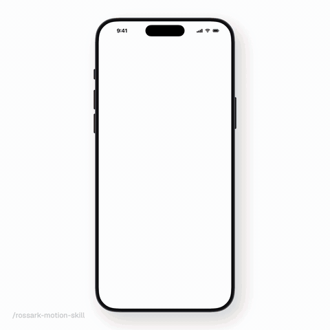
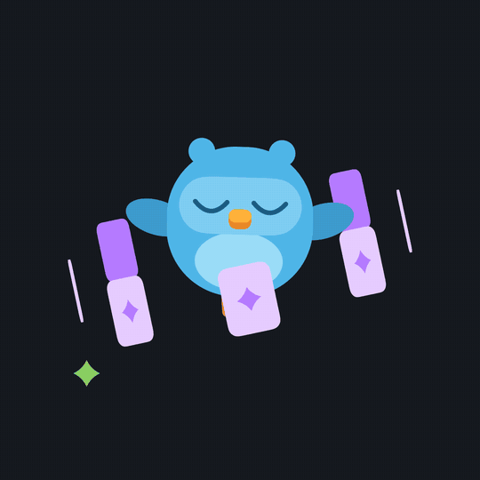

<a href="demo/reveal.mp4">

</a>

# Motion For Anything You Draw

For designers and engineers who want to bring their apps and drawings to life.

Making a drawing move is easy. Making it feel alive is hard: it has to breathe, look around, blink, shift its weight and act, without ever freezing or jumping. This skill helps your agent get there.

It started as the method I used to bring the illustrations in my app to life, and grew into a way to animate anything drawn: characters and creatures, plants, cloth, fire, smoke, water, weather, lights, machines, icons, logos, charts and whole scenes.

The animation above is drawn and animated entirely in code, with the templates in this repo.

## Install

```bash
npx skills@latest add rossark0/rossark-motion-skill
```

## Why use it?

Agents don't animate like animators.

Ask an agent to bring a character to life and it will often swap one drawing for another, so the face teleports from one expression to the next. It moves through each pose with its own eased tween, so the body stops dead at every pose. Everything moves in sync, like a machine. Blinks are so short they flicker, everything bounces, and a thin line shows across the face where two shapes meet.

All these small things add up, and the result looks like a slideshow instead of something alive.

This skill lists those mistakes and how to fix them: one clock for the whole scene, parts that turn around their real pivots, trailing parts that follow a beat later, idle life that never stops, smooth paths through key poses, small amplitudes and strong curves. When you have a reference video, it measures the motion frame by frame before building, because what makes a reference feel alive is often too small to see.

For motion in an interface, it follows [Emil Kowalski's](https://github.com/emilkowalski/skills) rules and Benji Taylor's [Family values](https://benji.org/family-values).

## Reference

- **[SKILL.md](./SKILL.md)**: The skill. Principles, recipes for every kind of subject, live faces, full-body acting, scenes that tell an action, motion in an interface, pitfalls, working from a reference video, and a workflow.
- **[MOTION.md](./MOTION.md)**: A notes file for your project. Copy it next to your art and fill in Part 2 as you go: where the code is, your rules, what your art can't do, and how you check changes. The skill reads it first.
- **[motion.ts](./templates/react-native/motion.ts)** and **[Motion.swift](./templates/swiftui/Motion.swift)**: The engine, for React Native and SwiftUI. Loop and one-shot clocks, `track`, `flow` (smooth acting through key poses), `seg`, `wave`, `loop`, `bell`, `seeded` and the curves.
- **[liveFace.tsx](./templates/react-native/liveFace.tsx)** and **[LiveFace.swift](./templates/swiftui/LiveFace.swift)**: Live eyes and mouths that glide, blink and smile. You give them the geometry and the colours.
- **[sheet.sh](./tools/sheet.sh)**: Contact sheets of a video at its full frame rate, to study timing or check your own render.
- **[track_edges.py](./tools/track_edges.py)**: Measures a subject's edges frame by frame, to catch motion too small for the eye: a 2% jiggle, a float, a sway.
- **[sample_colors.py](./tools/sample_colors.py)**: Reads exact colours from a video frame.
- **[demo/](./demo)**: The scenes on this page, a phone frame and an offline renderer that turns them into MP4 and GIF.

## Demos

**Reveal** ([source](demo/RevealScene.swift), [MP4](demo/reveal.mp4)), at the top of this page. Full-body acting in a phone frame, on one clock, in a 9-second loop at 60 fps:
- a mystery silhouette floats in, its feet hanging limp, its shadow breathing with the height;
- the kid hovers, falls with gravity, squashes on landing and keeps the volume;
- poses flow into each other with `flow`, idle life never stops, and the head and forearms follow through;
- a ball rolls in from off screen, the eyes follow it, the kick hits at the middle of the swing, and the ball flies off spinning; then the kid turns to you and waves;
- a toy-like build seen from a little above: a big head, a short torso, round shoes and a wide oval shadow.

**Garden** ([source](demo/GardenScene.swift), [MP4](demo/garden.mp4)), a 10-second loop:


- she pulls the can back, then pours: drops fall in seeded arcs with gravity and the soil darkens as it gets wet;
- the stem grows in two pushes, the leaves unfurl one after another, and the petals open one by one with a small twist;
- a butterfly wanders in from off screen and lands, the stem dips under its weight, and her head and eyes track it all the way;
- she grins and hops, with her pigtails, hat and can trailing the motion; then the petals drift down and the plant settles back into the sprout.

**Chef** ([source](demo/ChefScene.swift), [MP4](demo/chef.mp4)), a 9.6-second loop:


- steam rises from the pan, the flame flickers on two waves, and the burner knob turns up before each flip;
- the first flip: knees dip, the pancake turns in the air under gravity, his eyes follow it and his head a beat later, and it lands with a squash;
- the second flip goes too high: surprise, it lands on his hat, the hat squashes and wobbles, the pancake slides off and he catches it with the pan;
- contact stays exact: every throw starts and ends where the pan or the hat really is, and the hand is solved onto the handle.

**Orbit** ([source](demo/OrbitScene.swift), [MP4](demo/orbit.mp4)):



- a ring of cards orbiting in depth: the fronts in front of the bird, the backs behind it, edge-on at the sides;
- the bird floats and tilts, its wings flutter, and its feet and tufts follow through;
- sparkles that appear and disappear once per loop, at seeded times.

To render them again on macOS 14+:

```bash
swiftc -parse-as-library -target arm64-apple-macos14 \
  templates/swiftui/Motion.swift templates/swiftui/LiveFace.swift demo/*.swift -o /tmp/render-demo
/tmp/render-demo reveal /tmp/frames phone fps=60   # or: garden, chef, orbit
ffmpeg -framerate 60 -i /tmp/frames/%04d.png -c:v libx264 -pix_fmt yuv420p -crf 20 demo/reveal.mp4
```
